  
  
  

  

## 🛡️ Daniel Widal

**Information Security Analyst · Cyber Threat Intelligence (CTI) · Threat Hunting · Detection Engineering**

Focused on the collection, enrichment, and operationalization of threat data — correlating **IOCs, TTPs, and adversary behaviors** to anticipate attack vectors, build proactive detection rules, and guide incident response.

My approach bridges **technical artifact analysis** (PCAP network traffic, malware samples, and application/network logs) with **MITRE ATT&CK mapping**, turning raw telemetry into actionable intelligence for **Cloudflare WAF, SIEM (Wazuh), and observability pipelines (Grafana)**. In my research lab, I operate a **custom Python-powered honeypot** as a primary telemetry source for threat hunting and Kill Chain reconstruction.

  
  
  
  
  

---

## 🎯 Applied Intelligence Lifecycle

How I transform telemetry and malicious artifacts into proactive defense:

| Phase | Technical Execution |
| :--- | :--- |
| **01 · Collection & Telemetry** | Capturing malicious traffic via honeypots, WAF/SIEM logs, OSINT feeds, and network captures (PCAP). |
| **02 · Enrichment** | Extraction, validation, and defanging of IOCs (hashes, domains, IPs, C2) via VirusTotal, ANY.RUN, and static/dynamic analysis. |
| **03 · TTP Analysis** | Kill Chain reconstruction, identification of native binary abuse (*LOLBins*), and **MITRE ATT&CK** mapping. |
| **04 · Operationalization** | Translating intelligence into blocking and detection rules (WAF, SIEM/Wazuh, YARA/Sigma) and proactive hunts. |

---

## 🔬 Threat Intelligence & Malware/Network Analysis

Technical investigations focused on **payload extraction, behavioral threat analysis, TTP mapping, and actionable IOC generation**.

### 🕸️ Dossier 01: DanaBot — Network Traffic & Kill Chain

> **Network traffic (PCAP) investigation of a multi-stage DanaBot malware infection, isolating disguised payloads, C2 infrastructure, and adversary TTPs.**

`Wireshark` `Network Analysis` `VirusTotal` `ANY.RUN` `PowerShell` `MITRE ATT&CK` `OSINT`

- **Deep Packet Inspection:** Identified attack origin and initial vector via HTTP GET requests.
- **Payload Extraction:** Reconstructed HTTP streams to isolate malicious artifacts (`.js` disguised as `.php`) and secondary payloads (`.dll`).
- **Behavioral & LOLBins Mapping:** Analyzed sandbox execution tree, identifying `wscript.exe` abuse for stealthy execution.
- **IOC Reporting:** Generated file hashes (SHA-256/MD5) and defanged indicators to feed defensive rules.

🔗 **[Access Full Dossier →](https://github.com/Pendragon711/danabot-dfir-investigation)**

---

### 🔎 Dossier 02: XLMRat — Delivery Chain & Malware Triage

> **Analysis of the delivery and execution chain of AsyncRAT (XLMRat scenario), correlating network and host artifacts for IOC extraction and MITRE ATT&CK mapping.**

`Wireshark` `CyberChef` `VirusTotal` `Python` `MITRE ATT&CK`

- **Traffic & Artifact Analysis:** Identified initial HTTP download containing a `.jpg` file with a spoofed header.
- **Deobfuscation:** Payload deobfuscation and extraction of compilation metadata/timestamps from the malicious binary.
- **Defense Evasion Tracking:** Mapped abuse of the `RegSvcs.exe` LOLBin for process injection and defense evasion.
- **MITRE ATT&CK Mapping:** Full classification of observed techniques (`T1105`, `T1059.001`, `T1218.009`, `T1620`) and IOC report delivery.

🔗 **[Access Full Dossier →](https://github.com/Pendragon711/xlmrat-dfir-investigation)**

---

### 🛡️ CTI Workbench: ARGOS CTI — Threat Intelligence Platform

> **Local-first cyber threat intelligence platform in Go with SQLite persistence, embedded 5-step Web UI (`127.0.0.1:8080`), concurrent multi-provider enrichment, SHA-256 evidence tracking, depth-bounded graph pivoting, and STIX 2.1 / Markdown / CSV / JSON export.**

`Go` `SQLite` `Web UI` `STIX 2.1` `AbuseIPDB` `VirusTotal` `OTX` `CrowdSec`

- **Ingestion, Triage & Multi-Provider Enrichment:** Extracts and normalizes IPs, domains, URLs, hashes, and emails (including defanged indicators and `key=value` log fields) with concurrent lookups across AbuseIPDB, VirusTotal, AlienVault OTX, and CrowdSec CTI.
- **Guided 5-Step Workflow & Export:** Covers Case & Scope, Ingestion & Triage, Evidence (with certainty levels and automatic SHA-256 digests), Relationships & Pivot, and Case Assessment with Markdown, STIX 2.1, CSV, and JSON exports.

🔗 **[Explore ARGOS Repository →](https://github.com/Pendragon711/argos-cti)**

---

## ⚔️ Attack Surface & Recon (Offensive Perspective)

Mapping exposed attack surfaces is critical to anticipate exploitation vectors and prioritize defenses.

- 👁️ **[ODIN](https://github.com/Pendragon711/odin-recon)** — Automated reconnaissance and Attack Surface Management (ASM) pipeline written in Go (`Subfinder`, `Naabu`, `HTTPX`) for asset discovery and WAF detection.

---

## 🧰 Security Stack & Tools

### 🎯 Threat Intelligence & Analysis

  
  
  
  

**Focus:** IOC Enrichment • TTP Mapping • PCAP & Payload Analysis • Malware Triage • Attack Surface Recon

### 🛡️ Detection Engineering, SIEM & AppSec

  
  
  
  

**Focus:** Threat Hunting • Log Correlation • Custom Detection Rules • WAF Mitigation • Traffic Anomaly Analysis

### ⚙️ Automation & Infrastructure

  
  
  
  

---

## 🎓 Education & Certifications

- 🎓 **B.Tech in Cybersecurity** — UniCesumar *(In progress)*
- 📜 **Google Cybersecurity Professional Certificate** — Coursera
- 📜 **Cisco Junior Cybersecurity Analyst** — Cisco Networking Academy
- 📜 **SOC Analyst in the AI Era** — IBSEC
- 📜 **SOC Fundamentals** — Be Safe Inc.
- 📜 **AWS Cloud Practitioner Essentials** — Amazon Web Services
- 📜 **Nano Course Cybersecurity** — FIAP

---

## 📊 Telemetry & GitHub Stats

  
  

---

## 📫 Connect with me

  
  
  

---

  ◈ <strong>"Turn raw threat data into actionable defense."</strong> ◈

