

  
  
  

  

Profissional de Segurança da Informação com foco em **Operações de SOC (N1/N2)**, **Cyber Threat Intelligence (CTI)** e **Threat Hunting**. Atuo na análise de alertas, investigação de tráfego e operacionalização de **IOCs e TTPs** para apoiar a resposta a incidentes e a defesa proativa. Minha abordagem conecta **análise técnica de artefatos** (tráfego PCAP, triagem de malware e logs de rede/aplicação) com **mapeamento via MITRE ATT&CK** para proteção em **Cloudflare WAF, Next-Generation Firewalls (FortiGate), SIEM (Wazuh) e Grafana/Loki**, mantendo em laboratório um **honeypot próprio em Python** como fonte de telemetria.

  
  
  
  
  

 

  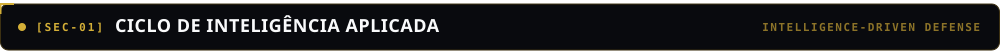

  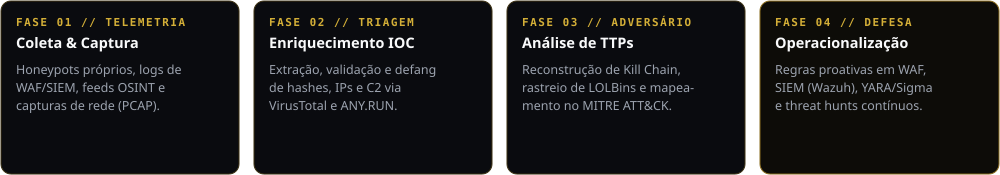

 

  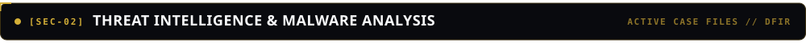

  <a href="https://github.com/Pendragon711/danabot-dfir-investigation">
    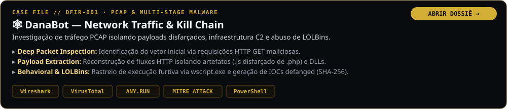
  </a>

  <a href="https://github.com/Pendragon711/xlmrat-dfir-investigation">
    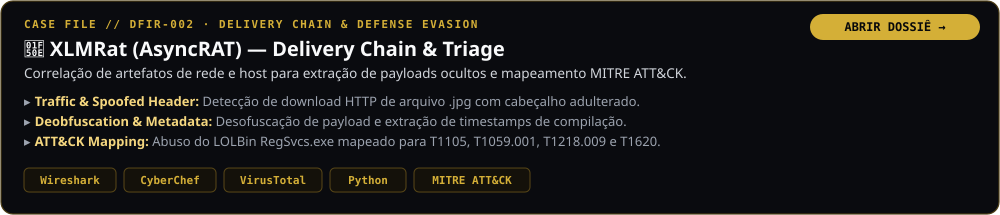
  </a>

  <a href="https://github.com/Pendragon711/argos-cti">
    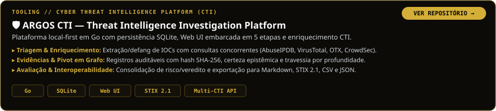
  </a>

 

  

  <a href="https://github.com/Pendragon711/odin-recon">
    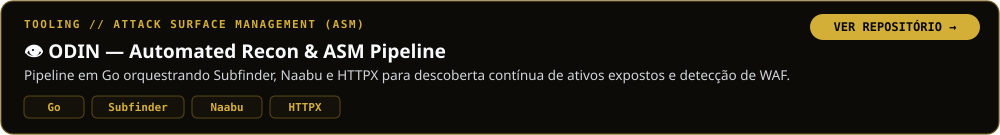
  </a>

 

  

**🎯 Threat Intelligence & Analysis** — *IOC Enrichment • TTP Mapping • PCAP & Payload Analysis • Malware Triage*

  
  
  
  

**🛡️ SOC Operations, SIEM, WAF & Firewalls** — *Incident Triage • Log Correlation • Threat Hunting • Perimeter Mitigation*

  
  
  
  
  

**⚙️ Automação & Infraestrutura**

  
  
  
  

 

  

- 🎓 **Graduação em Cibersegurança** — UniCesumar *(Em andamento)*
- 📜 **Foundation Level Threat Intelligence Analyst (FTIA)** — arcX
- 📜 **Google Cybersecurity Professional Certificate** — Coursera
- 📜 **Cisco Junior Cybersecurity Analyst** — Cisco Networking Academy
- 📜 **Fortinet NSE 3: FortiGate Operator** — Fortinet
- 📜 **Fortinet NSE 2: Next Generation Firewalls** — Fortinet
- 📜 **Fortinet NSE 1: Cybersecurity and Cloud Fundamentals** — Fortinet
- 📜 **Analista SOC na Era da IA** — IBSEC
- 📜 **Pentester na Era da IA** — IBSEC
- 📜 **Nano Course Cybersecurity** — FIAP

  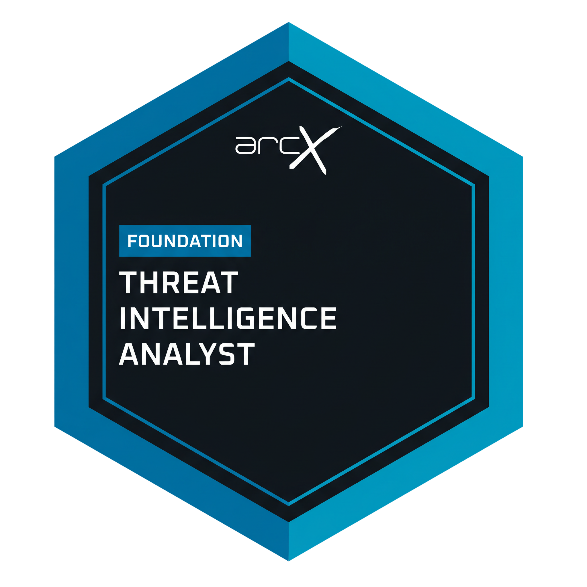&nbsp;&nbsp;
  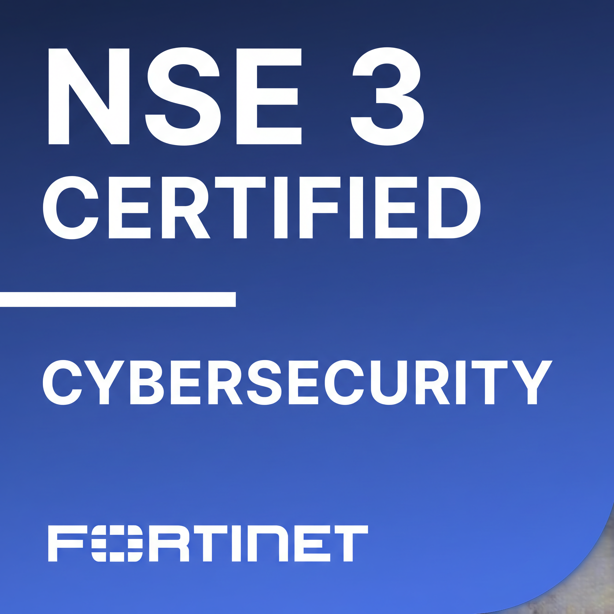&nbsp;&nbsp;
  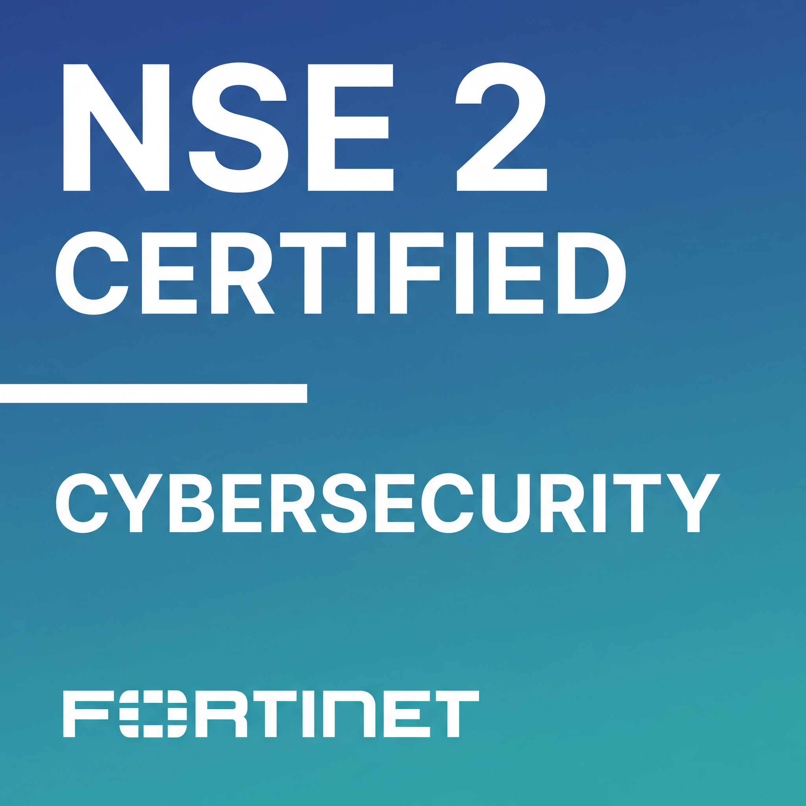&nbsp;&nbsp;
  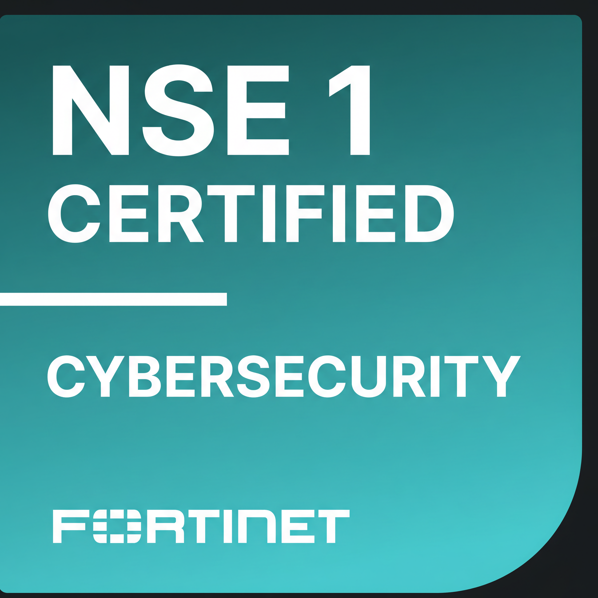&nbsp;&nbsp;
  &nbsp;&nbsp;
  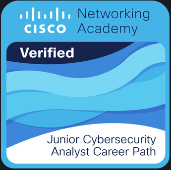&nbsp;&nbsp;
  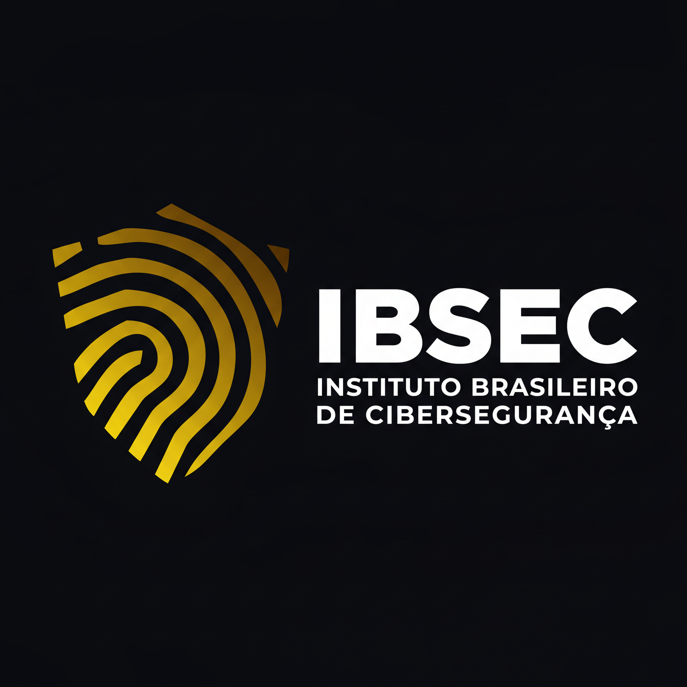&nbsp;&nbsp;
  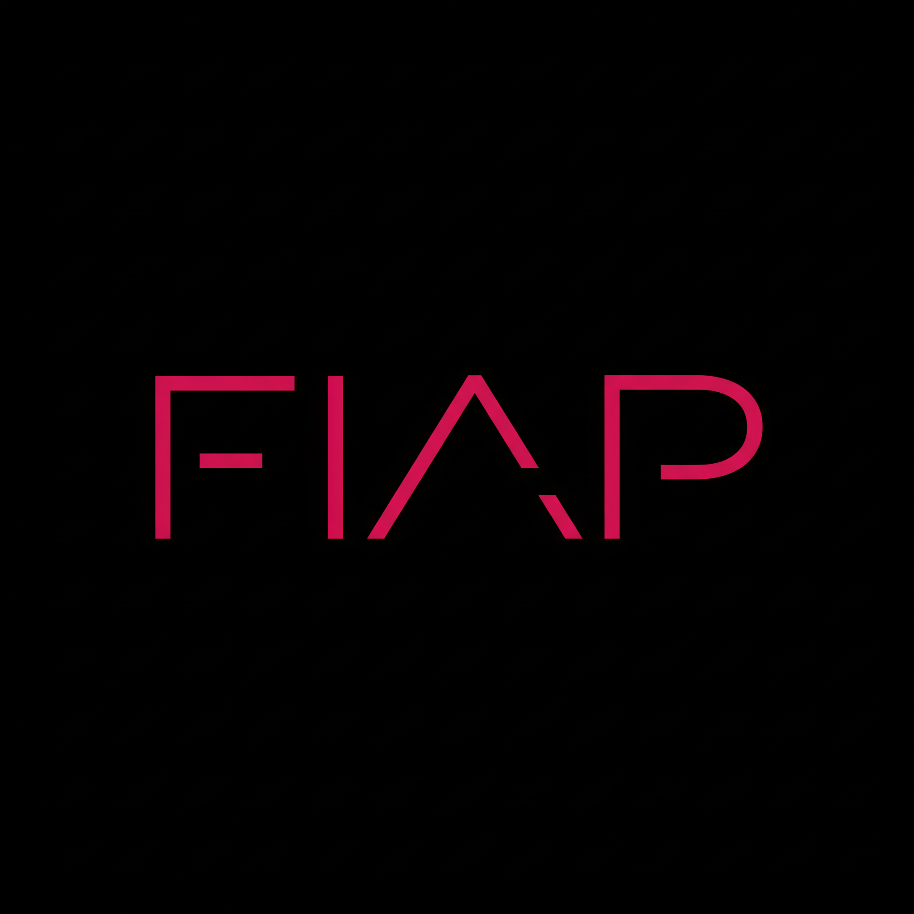

 

  

  
  

 

  

  
  
  

 

  

