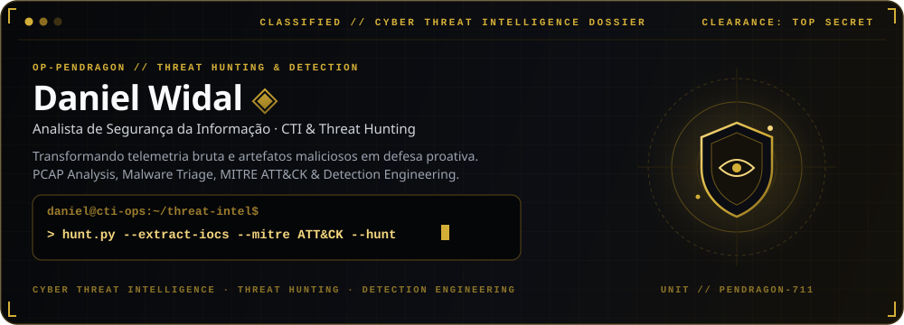

  
  
  

  

## 🛡️ Daniel Widal

**Analista de Segurança da Informação · Cyber Threat Intelligence (CTI) · Threat Hunting · Detection Engineering**

Atuo na coleta, enriquecimento e operacionalização de dados de ameaças — correlacionando **IOCs, TTPs e comportamentos adversários** para antecipar vetores de ataque, criar regras de detecção proativas e orientar a resposta a incidentes.

Minha abordagem conecta **análise técnica de artefatos** (tráfego PCAP, malwares e logs de aplicação/rede) com **mapeamento via MITRE ATT&CK**, transformando telemetria bruta em inteligência acionável para defesas em **Cloudflare WAF, SIEM (Wazuh) e ambientes de observabilidade (Grafana)**. No laboratório de pesquisa, mantenho um **honeypot com motor próprio de detecção em Python** como fonte primária de telemetria para threat hunting e reconstrução de Kill Chain.

  
  
  
  
  

---

## 🎯 Ciclo de Inteligência Aplicada

Como transformo telemetria e artefatos maliciosos em defesa proativa:

| Fase | Execução Técnica |
| :--- | :--- |
| **01 · Coleta & Telemetria** | Captura de tráfego malicioso via honeypots, logs de WAF/SIEM, feeds OSINT e amostras de rede (PCAP). |
| **02 · Enriquecimento** | Extração, validação e higienização (*defang*) de IOCs (hashes, domínios, IPs, C2) via VirusTotal, ANY.RUN e análise estática/dinâmica. |
| **03 · Análise de TTPs** | Reconstrução da Kill Chain, identificação de abuso de binários nativos (*LOLBins*) e mapeamento no **MITRE ATT&CK**. |
| **04 · Operacionalização** | Conversão da inteligência em regras de bloqueio e detecção (WAF, SIEM/Wazuh, YARA/Sigma) e hunts proativos. |

---

## 🔬 Threat Intelligence & Malware/Network Analysis

Investigações técnicas focadas em **extração de payloads, análise comportamental de ameaças, mapeamento de TTPs e geração de IOCs acionáveis**.

### 🕸️ Dossiê 01: DanaBot — Network Traffic & Kill Chain

> **Investigação de tráfego de rede (PCAP) de uma infecção multi-estágio do malware DanaBot, isolando payloads disfarçados, infraestrutura de C2 e TTPs do adversário.**

`Wireshark` `Network Analysis` `VirusTotal` `ANY.RUN` `PowerShell` `MITRE ATT&CK` `OSINT`

- **Deep Packet Inspection:** Identificação da origem do ataque e do vetor inicial via requisições HTTP GET.
- **Payload Extraction:** Reconstrução de fluxos HTTP para isolar artefatos maliciosos (`.js` disfarçado de `.php`) e payloads secundários (`.dll`).
- **Behavioral & LOLBins Mapping:** Análise da árvore de execução em sandbox, identificando o abuso de `wscript.exe` para execução furtiva.
- **IOC Reporting:** Geração de assinaturas (SHA-256/MD5) e documentação de indicadores (*defanged*) para alimentação de regras defensivas.

🔗 **[Acessar Dossiê Completo →](https://github.com/Pendragon711/danabot-dfir-investigation)**

---

### 🔎 Dossiê 02: XLMRat — Delivery Chain & Malware Triage

> **Análise da cadeia de entrega e execução do AsyncRAT (cenário XLMRat), correlacionando artefatos de rede e sistema para extração de indicadores e mapeamento MITRE ATT&CK.**

`Wireshark` `CyberChef` `VirusTotal` `Python` `MITRE ATT&CK`

- **Traffic & Artifact Analysis:** Identificação do download inicial via HTTP contendo um arquivo `.jpg` com cabeçalho adulterado.
- **Deobfuscation:** Desofuscação de payload e extração de metadados/timestamp de compilação do executável malicioso.
- **Defense Evasion Tracking:** Mapeamento do abuso do LOLBin `RegSvcs.exe` para injeção e evasão de defesa.
- **MITRE ATT&CK Mapping:** Classificação completa das técnicas observadas (`T1105`, `T1059.001`, `T1218.009`, `T1620`) e entrega de relatório de IOCs.

🔗 **[Acessar Dossiê Completo →](https://github.com/Pendragon711/xlmrat-dfir-investigation)**

---

## ⚔️ Attack Surface & Recon (Visão Ofensiva)

Mapear a superfície de ataque exposta é essencial para antecipar vetores de exploração e priorizar defesas.

- 👁️ **[ODIN](https://github.com/Pendragon711/odin-recon)** — Pipeline automatizado de reconhecimento e Attack Surface Management (ASM) em Go (`Subfinder`, `Naabu`, `HTTPX`) para descoberta de ativos e detecção de WAF.

---

## 🧰 Security Stack & Tools

### 🎯 Threat Intelligence & Analysis

  
  
  
  

**Foco:** IOC Enrichment • TTP Mapping • PCAP & Payload Analysis • Malware Triage • Attack Surface Recon

### 🛡️ Detection Engineering, SIEM & AppSec

  
  
  
  

**Foco:** Threat Hunting • Log Correlation • Custom Detection Rules • WAF Mitigation • Traffic Anomaly Analysis

### ⚙️ Automação & Infraestrutura

  
  
  
  

---

## 🎓 Formação & Certificações

- 🎓 **Graduação em Cibersegurança** — UniCesumar *(Em andamento)*
- 📜 **Google Cybersecurity Professional Certificate** — Coursera
- 📜 **Cisco Junior Cybersecurity Analyst** — Cisco Networking Academy
- 📜 **Analista de SOC na Era da IA** — IBSEC
- 📜 **Fundamentos de SOC** — Be Safe Inc.
- 📜 **AWS Cloud Practitioner Essentials** — Amazon Web Services
- 📜 **Nano Course Cybersecurity** — FIAP

---

## 📊 Telemetria & GitHub Stats

  
  

---

## 📫 Conecte-se comigo

  
  
  

---

  ◈ <strong>"Turn raw threat data into actionable defense."</strong> ◈

